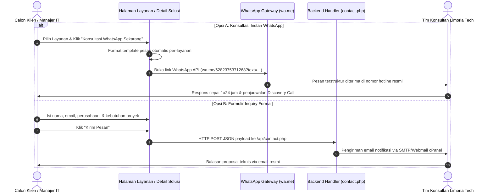

# Arsitektur Teknis — PT Limoria Teknologi Indonesia

Dokumentasi ini menjelaskan arsitektur perangkat lunak, tumpukan teknologi (*tech stack*), pola rekayasa, manajemen konten modular, dan strategi performa yang diterapkan pada platform **PT Limoria Teknologi Indonesia (Limoria Tech)**.

---

## 1. Tumpukan Teknologi (Tech Stack)

| Komponen | Teknologi | Versi | Catatan & Peran |
| :--- | :--- | :--- | :--- |
| **Framework** | Next.js (App Router) | 16.3.6 | Menggunakan Turbopack untuk kompilasi build ultra cepat |
| **Runtime / Library** | React & React DOM | 19.2.8 | Server Components & Client Interactive Components |
| **Bahasa Pemrograman** | TypeScript | ^5.x | *Strict typing* menyeluruh untuk model data, DAO, dan metadata |
| **Styling & Design System**| Tailwind CSS v4 | ^4.x | Utilitas modern tanpa dependensi file konfigurasi ganda |
| **Ikonografi** | Lucide React | ^1.48.x | Ikon vektor SVG ringan, konsisten, dan modular |
| **Deployment Mode** | Static Site Generation (SSG) | `output: "export"` | Kompatibel penuh dengan cPanel / LiteSpeed Shared Hosting |

---

## 2. Prinsip Arsitektur Utama

### A. 100% Static Site Generation (SSG)
Konfigurasi pada [`next.config.ts`](file:///D:/Limoria%20Tech/limoriatech-compro/next.config.ts) menetapkan `output: "export"`, `trailingSlash: true`, dan `images: { unoptimized: true }`.
- Setiap rute halaman (`/`, `/about/`, `/contact/`, 20 rute `/services/[slug]/`, dan 9 rute `/portfolio/[slug]/`) di-render pada saat build menjadi berkas HTML, CSS, dan JavaScript statis di folder `out/`.
- **Keuntungan:** Waktu muat awal (*First Contentful Paint*) sangat instan (< 0.8s), keamanan tinggi karena tidak ada eksekusi runtime server Node.js dinamis di hosting, serta kebal terhadap *Error 508 Resource Limit Reached* pada Shared Hosting.
- **Batasan:** Menghindari pemanggilan cookie/header dinamis server seperti `cookies()` atau `headers()` pada rute publik.

### B. Modular Data Layer (Single Source of Truth)
Seluruh data bisnis dipisahkan secara terisolasi dari komponen visual dan disimpan dalam format JSON di [`src/data/`](file:///D:/Limoria%20Tech/limoriatech-compro/src/data/):
- [`src/data/services.json`](file:///D:/Limoria%20Tech/limoriatech-compro/src/data/services.json): Katalog 20 layanan (Tech & Financial), fitur, deliverables, benefits, dan FAQ.
- [`src/data/portfolio.json`](file:///D:/Limoria%20Tech/limoriatech-compro/src/data/portfolio.json): 9 studi kasus proyek, impact metrics kuantitatif, tantangan, dan solusi arsitektur.
- [`src/data/app-development.json`](file:///D:/Limoria%20Tech/limoriatech-compro/src/data/app-development.json): 7 spesialisasi rekayasa aplikasi (Web, Mobile, Desktop, ERP, Cloud, AI, dll.).
- [`src/data/site-config.json`](file:///D:/Limoria%20Tech/limoriatech-compro/src/data/site-config.json): Profil legal PT, kontak hotline, alamat kantor Kebayoran Baru, jam layanan, dan token verifikasi GSC.
- [`src/data/navigation.json`](file:///D:/Limoria%20Tech/limoriatech-compro/src/data/navigation.json): Susunan menu header desktop, dropdown layanan, dan footer links.

### C. Data Access Object (DAO) Pattern
Komponen UI tidak mengimpor langsung file JSON mentah, melainkan melalui helper repository di [`src/lib/data/`](file:///D:/Limoria%20Tech/limoriatech-compro/src/lib/data/):
- [`getServices()`](file:///D:/Limoria%20Tech/limoriatech-compro/src/lib/data/services.ts), [`getServiceBySlug(slug)`](file:///D:/Limoria%20Tech/limoriatech-compro/src/lib/data/services.ts), [`getAllServiceSlugs()`](file:///D:/Limoria%20Tech/limoriatech-compro/src/lib/data/services.ts)
- [`getPortfolioProjects()`](file:///D:/Limoria%20Tech/limoriatech-compro/src/lib/data/portfolio.ts), [`getProjectBySlug(slug)`](file:///D:/Limoria%20Tech/limoriatech-compro/src/lib/data/portfolio.ts), [`getAllPortfolioSlugs()`](file:///D:/Limoria%20Tech/limoriatech-compro/src/lib/data/portfolio.ts)
- [`getSiteConfig()`](file:///D:/Limoria%20Tech/limoriatech-compro/src/lib/data/site.ts), [`getNavigation()`](file:///D:/Limoria%20Tech/limoriatech-compro/src/lib/data/site.ts)

### D. Sistem Multi-Bahasa Client-Side (i18n)
Dikelola melalui [`LanguageContext.tsx`](file:///D:/Limoria%20Tech/limoriatech-compro/src/context/LanguageContext.tsx) dan utilitas [`src/lib/utils.ts`](file:///D:/Limoria%20Tech/limoriatech-compro/src/lib/utils.ts):
- Mendukung Bahasa Indonesia (`id`) dan English (`en`) tanpa memecah rute menjadi subfolder bahasa (`/en/`, `/id/`), sehingga menjaga integritas SSG.
- Model data menggunakan tipe generic `Localized<T> = T | { id: T; en: T }`.
- Preferensi bahasa tersimpan otomatis di `localStorage`.
- Panduan lengkap tersedia di [`04-I18N-LOCALIZATION.md`](file:///D:/Limoria%20Tech/limoriatech-compro/docs/04-I18N-LOCALIZATION.md).

### E. Optimasi SEO, Schema.org & Rich Snippets Terintegrasi
- **OpenGraph & Twitter Cards:** Banner resmi resolusi 1200×630px (`public/assets/og-image.png`).
- **Structured Data JSON-LD:** Menanamkan Schema `ProfessionalService`, `WebSite`, `Service`, `CreativeWork`, `BreadcrumbList`, dan `FAQPage`.
- **Sitemap & Robots Otomatis:** Di-generate saat build via [`sitemap.ts`](file:///D:/Limoria%20Tech/limoriatech-compro/src/app/sitemap.ts) (41 URLs) dan [`robots.ts`](file:///D:/Limoria%20Tech/limoriatech-compro/src/app/robots.ts).
- Panduan lengkap tersedia di [`05-SEO-AND-METADATA.md`](file:///D:/Limoria%20Tech/limoriatech-compro/docs/05-SEO-AND-METADATA.md).

---

## 3. Struktur Pohon Direktori

```
limoriatech-compro/
├── docs/                             # [DOKUMENTASI SISTEM & OPERASIONAL]
│   ├── README.md                     # Documentation Hub & Peta Panduan
│   ├── 01-ARCHITECTURE.md            # Arsitektur sistem, SSG Next.js 16, & DAO layer
│   ├── 02-SERVICES-CATALOG-GUIDE.md  # Panduan 20 layanan, deliverables & FAQ dwibahasa
│   ├── 03-PORTFOLIO-CASE-STUDIES.md  # Panduan 9 portofolio studi kasus & rasio visual
│   ├── 04-I18N-LOCALIZATION.md       # Panduan sistem bilingual (ID/EN) & helper utils
│   ├── 05-SEO-AND-METADATA.md        # Panduan SEO, Schema.org, sitemap & OpenGraph
│   ├── 06-DEPLOYMENT-CPANEL.md       # Panduan build, script packaging Python, & .htaccess
│   └── 07-GOOGLE-SEARCH-CONSOLE.md   # Panduan verifikasi domain Google & submit sitemap
│
├── public/                           # Aset publik statis
│   ├── .htaccess                     # Konfigurasi Apache / LiteSpeed cPanel & HTTPS
│   ├── favicon.ico, icon-192, 512    # Favicon & Web App Manifest Icons
│   ├── google57jJrZwvruJGTkVT0geNcXupCRT1-xR0N_D3_r1AM4o.html # Verifikasi Google
│   ├── api/contact.php               # Handler pengiriman email form kontak
│   └── assets/
│       ├── og-image.png              # Banner Social Card resmi (1200x630px)
│       └── portfolio/                # Banner proyek studi kasus (16:9 ratio)
│
├── scripts/                          # Otomasi & Utility Scripts
│   ├── bundle-cpanel.py              # Script bundler cPanel & Windows RSC fix
│   ├── generate-og-image.py          # Generator kartu OpenGraph via Pillow
│   └── add-service-faqs.py           # Generator data FAQ dwibahasa
│
├── src/
│   ├── app/                          # Next.js App Router (Halaman & Rute)
│   │   ├── layout.tsx                # Root Layout (Navbar, Footer, SEO & Schema)
│   │   ├── page.tsx                  # Beranda Utama
│   │   ├── about/page.tsx            # Halaman Tentang Kami
│   │   ├── contact/page.tsx          # Halaman Kontak & Form Inquiry
│   │   ├── services/                 # Katalog Layanan & Rute Dinamis [slug]
│   │   ├── portfolio/                # Portofolio & Rute Dinamis [slug]
│   │   ├── sitemap.ts                # Generator otomatis sitemap.xml
│   │   └── robots.ts                 # Generator otomatis robots.txt
│   │
│   ├── components/                   # Komponen Reusable
│   │   ├── layout/                   # Navbar & Footer
│   │   ├── seo/                      # JsonLd helper script
│   │   └── ui/                       # Atomic UI (Button, Card, Badge, Input, dll.)
│   │
│   ├── context/                      # React Context (LanguageContext)
│   ├── data/                         # JSON Data Layer (Single Source of Truth)
│   ├── features/                     # Komponen Berorientasi Fitur
│   │   ├── home/                     # Modul Beranda (Hero, TechStack, Value, CTA)
│   │   ├── about/                    # Modul Tentang Kami
│   │   ├── services/                 # Modul Layanan (Katalog, Detail, FAQ Section)
│   │   ├── portfolio/                # Modul Portofolio & Detail Studi Kasus
│   │   └── contact/                  # Modul Kontak & Form Handling
│   │
│   ├── lib/                          # Utility & Data Access Objects
│   │   ├── utils.ts                  # Helper cn() & getLocalized()
│   │   ├── data/                     # DAO functions (site, services, portfolio)
│   │   └── seo/                      # Schema.org generator (Org, WebSite, Service, FAQ)
│   │
│   └── types/                        # TypeScript Interface & Type Definitions
```

---

## 4. Alur Integrasi Konsultasi WhatsApp & Inquiry

Platform ini memadukan kemudahan konsultasi instan WhatsApp direct-to-chat dan formulir formal *enterprise request-for-proposal*:


